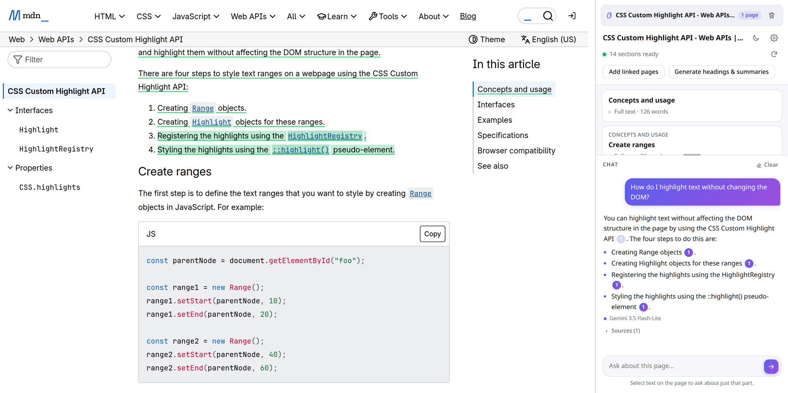
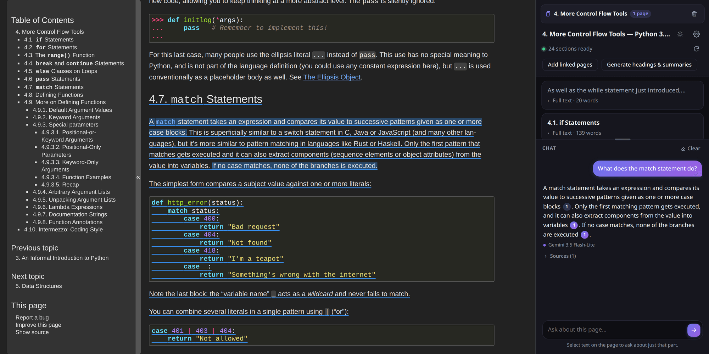
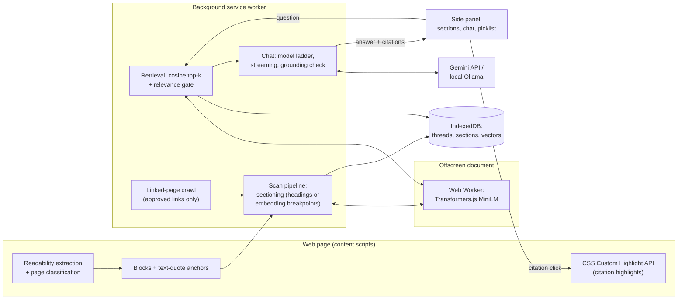

# Docent

*Read less, know more.* Ask your docs and web pages questions; every answer points to the exact line it came from.



<sub>Docent beside MDN's CSS Custom Highlight API docs. The answer comes only from the page, and clicking citation [1] highlights its source on the page.</sub>



<sub>The Python tutorial in dark mode: the cited sentences are highlighted, and the rest of their section is underlined.</sub>

Docent is a Chrome extension that turns the page you're reading into a chatbot you can question. Scan the page, ask, and get an answer drawn only from that page (or from linked pages you choose to add). Each answer has numbered citations, and clicking one highlights the source sentence on the page.

Pages are read, split into sections and searched entirely in the browser. Only your question and the few sections it needs go to the model that writes the answer: Google Gemini's free tier, or a model on your own machine through Ollama.

---

## Technical highlights

- **Retrieval runs in the browser, with no backend.** `all-MiniLM-L6-v2` runs through Transformers.js in a Web Worker hosted by an MV3 offscreen document, since service workers can't start workers. Vectors live in IndexedDB and are searched by cosine similarity. Each section gets several vectors, because the model reads only its first 256 tokens.
- **Citations that point at the live page.** Sections are stored as text-quote anchors, not DOM references, and re-anchored when a page is opened. Highlights use the CSS Custom Highlight API, so the page's DOM is never changed. Anchoring rate: 99–100% on 10 varied sites.
- **Hallucination guards on both sides of the model.** A relevance gate keeps off-topic questions from reaching the model at all. After the answer, each sentence is checked against its sources (embedding similarity, word coverage, and an exact match on any numbers). Unsupported sentences are underlined, and an answer with nothing from the sources is hidden. The cutoffs were calibrated on labelled claims ([results](#measured-results)).
- **Sectioning that adapts to the page.** Pages with headings are split by heading. Pages without headings are split where the embedding of the next paragraph drifts from the running section's centroid. The cutoff is set from each page's own similarity profile (mean − 0.5 sd), not a fixed constant.
- **A free-tier model ladder.** Chat streams from the newest stable Gemini Flash model. When a model's daily quota or timeout is hit, chat steps down through other Flash models, then Flash-Lite, then local Ollama, and the line under each answer names the model that answered.

Plain JavaScript, no build step. 164 unit tests over the pure logic in `lib/` (`npm test`, no dependencies).

## Measured results

Measured on a laptop (Intel i5-1235U, no GPU) in November 2026. These are small samples, not a benchmark suite. Details and methods are in the [phase plans](docs/phased-implementation-plan/).

**Scan time** (extract, section, embed; embedding model already cached; median of 3 runs):

| Page | Words | Scan |
|---|---|---|
| MDN: CSS Custom Highlight API | 592 | 2.1 s |
| react.dev: Thinking in React | 2,704 | 7.2 s |
| Python tutorial: control flow | 5,554 | 12.3 s |
| Wikipedia: Photosynthesis | 7,595 | 13.3 s |
| Paul Graham: How to Do Great Work (no headings) | 10,436 | 24.5 s |

The very first scan also downloads the 23 MB embedding model: 9.2 s in total for the MDN page.

**Time to first words of an answer:** 1.6–6.3 s with Gemini Flash (7 questions across 4 pages; median 2.4 s). Local `qwen2.5:1.5b` on this CPU took 22–115 s.

**Citation anchoring:** 99–100% of text blocks re-anchored to the live page on 10 varied sites (Wikipedia in two languages, MDN, a GitHub README, a news site, blogs, an old table-layout page). All 204 sections highlighted exactly.

**Grounding check** (calibrated on 20 answers a small model made up from memory, plus true claims reworded from the sources):

| | |
|---|---|
| True sentences kept (not underlined) | 90% |
| Made-up sentences caught | 60% |
| Made-up answers with at least one sentence underlined | 14 / 20 |
| Made-up answers hidden entirely | 8 / 20 |

The two kinds of score overlap, so no single cutoff separates them cleanly. The cutoff favours few false underlines, and invented numbers are caught either way. On real on-page questions, all 7 Gemini answers passed. Of 12 `qwen2.5:1.5b` answers, 6 had at least one sentence underlined.

---

## Quick start

Needs **Chrome 116+** and **Node.js 18+** (Node is used only for the vendor step and the tests).

```sh
git clone <this repository>
cd docent
npm run vendor        # fetches Transformers.js + the ONNX Runtime wasm (not committed), at pinned versions
```

1. Open `chrome://extensions`, turn on **Developer mode**, click **Load unpacked**, and choose the `docent` folder.
2. Click the toolbar icon to open the side panel, open **⚙**, and paste a free Gemini key from [Google AI Studio](https://aistudio.google.com/apikey). Or give it the name of a local Ollama model.
3. On any article or docs page, press **Start scan**, then ask.

The full manual covers Ollama setup, threads across pages, adding linked pages, explaining a selection, and troubleshooting: **[docs/user-guide.md](docs/user-guide.md)**.

### What leaves your browser

| Data | Where it goes |
|---|---|
| Page text, sections, the search index | Stays in the browser (IndexedDB) |
| Your question + the 5–8 sections it needs, plus recent chat turns | The model that writes the answer: Gemini, or your local Ollama |
| Your question, on "Search the web" (only when you click it) | The search engine you chose, in a normal tab |
| Your Gemini API key | This browser only (`chrome.storage.local`) |

The embedding model (about 23 MB) is downloaded from Hugging Face on the first scan and cached.

---

## Architecture



| Folder | What's in it |
|---|---|
| `background/` | Service worker: scan pipeline, chat, crawling, storage, model calls |
| `content/` | Content scripts: extraction, blocks and anchoring, links, highlighting |
| `offscreen/` | Offscreen document: hosts the embedding worker, parses fetched linked pages |
| `workers/` | Embedding Web Worker, plus vendored Transformers.js and ONNX Runtime |
| `sidepanel/` | The panel UI |
| `lib/` | Pure logic shared by all of the above, with unit tests (`*.test.js`) |
| `docs/` | Master spec, per-phase plans with test results, and the user guide |

**Design docs:** [`docs/master-spec.md`](docs/master-spec.md) is the source of truth for every decision, including the alternatives that were rejected. [`docs/phased-implementation-plan/`](docs/phased-implementation-plan/) holds each phase's plan, decisions and test results.

**Permissions:** `activeTab`, `scripting`, `sidePanel` and `storage`. `offscreen` hosts the embedding worker. `declarativeNetRequestWithHostAccess` plus `http://localhost:11434/*` lets the extension reach Ollama: it removes the `Origin` header from the extension's own requests to Ollama only. Access to all sites (`http(s)://*/*`) is optional and requested once, at runtime, from Start scan. The extension-pages CSP adds `'wasm-unsafe-eval'` so ONNX Runtime's WebAssembly can run.
